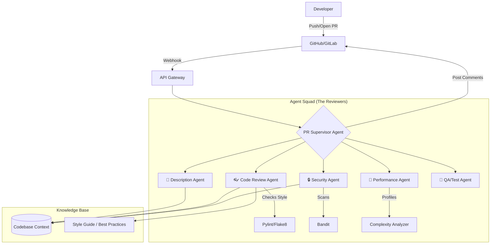

# 🤖 PR-Agent: Intelligent Pull Request Agent System

PR-Agent is an advanced AI-powered system that orchestrates multiple specialized agents to analyze, review, and document pull requests. It supports multiple interfaces including a FastMCP server, a Streamlit Web UI, and GitHub Actions CI/CD integration.

## 🏗️ System Architecture



## 🔒 Multi-Tenant Security & 🧠 Three-Tiered Cognitive Memory Architecture

PR-Agent implements an enterprise-grade multi-tenant security architecture and a **Three-Tiered Cognitive Memory Architecture** to guarantee absolute data isolation, high-performance context processing, and smart episodic context retrieval:

### 1. 🔒 Enterprise Multi-Tenant Security & Isolation

* **Contextvars-Based Propagation**: Uses Python `contextvars` to safely propagate `tenant_id` across asynchronous context switches and concurrent threads.
* **Tenant-Scoped Caching**: An isolated caching mechanism (`_tenant_cache`) that automatically scopes cache keys strictly by the active tenant ID to prevent any potential cross-tenant cache pollution.
* **Structured Auditing**: Formats and logs every tenant action (e.g., agent runs, cache queries) into `config/tenant_audit.log` for transparency and compliance.
* **Prompt Injection Protection**: Dynamic instruction hierarchy overrides that bind prompt execution scopes strictly within the active tenant boundaries.

### 2. 🧠 Three-Tiered Cognitive Memory Architecture

* **Tier 1: Working Memory (L1 - Immediate Focus)**: Employs high-density KV Cache prefix optimization and sliding-window diff slicing (`L1WorkingMemory.optimize_diff_context`) to fit large files into the active context window and prevent token limit overflows.
* **Tier 2: Episodic Memory (L2 - Events & Trajectories)**: Implements experience replay per tenant. Automatically logs execution results of successful agent trajectories and allows `PRQuestionsAgent` to retrieve past episodes to answer complex questions about past turns.
* **Tier 3: Semantic Memory (L3 - Facts & Rules)**: Enforces persistent style guidelines and custom team rules per tenant. Team rules are registered dynamically and injected into the LLM system prompt for strict guidelines enforcement.

### 3. ⚙️ Active Configuration & Usage

#### Setting/Managing Tenant Isolation

By default, the supervisor orchestrator and all specialized agents resolve the current tenant scope automatically based on the active thread or async task `contextvars`. You can manage it programmatically or via environment variables:

* **Environment Variable Override**: Set the primary tenant context using `DEFAULT_TENANT_ID`.

  ```bash
  export DEFAULT_TENANT_ID="enterprise_client_a"
  ```

* **Programmatic Assignment**: Scope agent executions dynamically within specific tenant namespaces in your Python code:

  ```python
  from src.tenant import set_current_tenant_id, tenant_scoped

  # Programmatic propagation across execution contexts
  set_current_tenant_id("customer_account_b")
  ```

#### Registering Semantic Style Guidelines (L3)

You can append custom guidelines or business rules directly into the L3 Semantic Memory layer per tenant to guide review logic:

```python
from src.memory import L3SemanticMemory
from src.tenant import set_current_tenant_id

set_current_tenant_id("engineering_team_x")
L3SemanticMemory.register_rule("All public REST endpoints must include explicit OAuth decorators.")
```

## 📂 Directory Structure

```plaintext
pr-agent/
├── 📂 .github/              # GitHub Actions & Dependabot
│   ├── workflows/           # CI/CD Workflows
│   │   └── security-scan.yml
│   └── dependabot.yml       # Dependency updates
├── 📂 docs/                 # Documentation
│   ├── CICD_SETUP.md        # GitHub Actions Setup
│   ├── PORTABLE_WORKFLOW.md # Portable usage guide
│   ├── QUICKSTART.md        # Quick start guide
│   ├── SECURITY.md          # Security policy
│   └── STREAMLIT_FORMATTING.md
├── 📂 src/                  # Source Code
│   ├── 📂 agents/           # Specialized LLM Agents
│   │   ├── base.py          # Base agent class
│   │   └── specialized.py   # All agent implementations
│   ├── analyzer.py          # Task dependency analyzer
│   ├── auth.py              # Authentication logic
│   ├── config.py            # Configuration management
│   ├── github_commenter.py  # GitHub PR commenting
│   ├── github_provider.py   # GitHub API interaction
│   ├── graph.py             # LangGraph orchestration
│   ├── memory.py            # Three-tiered cognitive memory system
│   ├── prompts.py           # Centralized LLM prompts
│   ├── schemas.py           # Pydantic validation schemas
│   ├── state.py             # Agent state definitions
│   ├── tenant.py            # Async-safe multi-tenant isolation
│   ├── tracing.py           # Optional Langfuse tracing integration
│   └── utils.py             # Utility functions
├── 📂 tests/                # Test suite
│   ├── test_functionality.py
│   └── verify_mcp.py
├── .env.example             # Environment variables template
├── cli.py                   # CLI Entry point
├── main.py                  # FastMCP Server Entry point
├── streamlit_app.py         # Streamlit Web UI Entry point
├── run_streamlit.sh         # Streamlit launcher script
├── run_agent.sh             # Agent launcher script
└── requirements.txt         # Python dependencies
```

## 🔄 How It Works

### 1. 🖥️ Streamlit Web UI (Interactive Mode)

**Interaction:** Users log in via the Web UI and interact directly with agents.

- **Architecture:** The Streamlit app imports agent classes (e.g., `CodeReviewAgent`) directly from `src.agents`.
- **Flow:** User Input → Streamlit App → `Agent.execute()` → LLM → Streamlit UI

#### 🔐 Authentication Features

| Feature             | Description                                                    |
| ------------------- | -------------------------------------------------------------- |
| **Login**           | Secure login with username/password using bcrypt hashing       |
| **Registration**    | New user registration with email and password validation       |
| **Forgot Password** | Email verification code flow for secure password reset         |
| **Change Password** | Logged-in users can update their password via sidebar expander |

**Security:**

- Passwords hashed using `bcrypt` with salt rounds (12)
- Session managed via encrypted cookies (configurable expiry: 30 days default)
- User credentials stored in `config/auth_config.yaml`
- Uses `streamlit-authenticator` library for secure authentication

### 2. 🔌 FastMCP Server (Assistant Mode)

**Interaction:** Designed for AI Assistants (like Claude Desktop) or IDEs (Cursor).

- **Architecture:** `main.py` uses `fastmcp` to expose functions as standardized tools.
- **Flow:** Claude/IDE → MCP Protocol → `main.py` → `app.ainvoke()` → Agents → Response
- **Tools:** Exposes `review_pr`, `describe_pr`, `ask_pr`, etc.

#### Public documentation for PR questions

The `ask_pr` MCP tool can use current public documentation when answering a PR
question. Supply a separate `public_web_query`, up to five `public_web_urls`, or
both. For example, call `ask_pr` with:

```json
{
  "pr_url": "https://github.com/owner/repo/pull/123",
  "tenant_id": "my-team",
  "question": "Does this change handle cancellation correctly?",
  "public_web_query": "Python asyncio cancellation documentation",
  "public_web_urls": ["https://docs.python.org/3/library/asyncio-task.html"]
}
```

Public lookups use [Parallel Search MCP](https://docs.parallel.ai/integrations/mcp/search-mcp)
at `https://search.parallel.ai/mcp`. Search uses Fast mode and needs no account or
API key. Only the separate public query and supplied URLs are sent to this
service, together with an opaque identifier for the tenant/PR conversation.
The PR diff, question, GitHub token and LLM credentials are not included in web
requests. Keep lookup inputs public. The answer model still receives the PR
context through the configured LLM provider, as usual.

Parallel is the default search provider for an unconfigured installation. No
web request is made when these lookup inputs are omitted. Set
`PR_AGENT_SEARCH_PROVIDER=none` to disable lookup, or
`PR_AGENT_WEB_SEARCH_ENABLED=false` to deny web access for all requests. Individual
calls can also set `web_search_enabled=false`; they cannot override the operator's
disabled setting. An unsupported provider returns an error without falling back.
These settings are read on each call and do not change the LLM provider.

Lookups have a 30-second total deadline, configurable with
`PR_AGENT_SEARCH_TIMEOUT` (greater than 0, at most 120 seconds). Queries are limited
to 1000 characters and URLs to 2048 characters each. URLs must use HTTP(S), standard
web ports and public hosts, without credentials. Results are bounded excerpts,
passed to the answer prompt as untrusted reference material with source URLs.
The prompt requests citations; their accuracy still depends on the answer model.
Lookup failures, including the free service's usage limits, return a clear error
instead of presenting an answer as web-verified. Cancellation propagates to the
MCP client. Web-assisted answers are retrieved afresh rather than cached; local
answers are cached per tenant, PR and question. Direct `PRQuestionsAgent` callers
can use the same fields in their state. The Streamlit form does not expose these
lookup fields.

### 3. 📈 Langfuse Tracing & Monitoring

PR-Agent can emit LangChain/LangGraph traces to Langfuse for monitoring LLM calls, fallbacks, latency, token usage, and per-tenant agent behavior. Tracing is optional and stays disabled unless Langfuse credentials are configured.

```bash
export LANGFUSE_PUBLIC_KEY="pk-lf-..."
export LANGFUSE_SECRET_KEY="sk-lf-..."
# PR-Agent accepts LANGFUSE_BASE_URL and maps it to the SDK's LANGFUSE_HOST.
export LANGFUSE_BASE_URL="https://cloud.langfuse.com"
# Optional explicit switch. Credentials alone also enable tracing.
export LANGFUSE_ENABLED=true
```

Each specialized agent invocation is traced with:

- `langfuse_user_id`: active `tenant_id`
- `langfuse_session_id`: PR URL, commit URL, or branch comparison key
- tags: `pr-agent` plus the agent run name
- metadata: tenant, agent name, and active LLM provider

This follows the Langfuse tracing model of one trace per system invocation and session grouping around the PR under review.

### 4. 🚀 GitHub Actions (CI/CD Mode)

**Interaction:** Validates code automatically on every Pull Request.

- **Architecture:** `cli.py` is invoked by the GitHub Action container.
- **Flow:** PR Event → GitHub Action → `cli.py` → `GitHubProvider` → Agents → PR Comment
- **Triggers:** `opened`, `synchronize`, `reopened` events or manual `workflow_dispatch`.

### 5. 🤖 Specialized Agent Squad

The system deploys a squad of specialized agents, each acting as a "Staff Engineer" in their domain:

| Agent                 | Persona           | Responsibilities                                           | Tools Integrated    |
| --------------------- | ----------------- | ---------------------------------------------------------- | ------------------- |
| **Code Review Agent** | Senior SWE        | General code quality, style, and logic checks.             | `pylint`, `flake8`  |
| **Security Agent**    | InfoSec Lead      | Vulnerability scanning (SQLi, Secrets, XSS).               | `bandit` (SAST)     |
| **Performance Agent** | SRE / Perf Expert | Identifying N+1 queries, complexity, and resource leaks.   | Complexity Analyzer |
| **Test Agent**        | QA Architect      | Verifying test coverage and suggesting missing test cases. | -                   |
| **Description Agent** | Technical Writer  | generating comprehensive PR descriptions and titles.       | -                   |

**Hybrid Neuro-Symbolic Analysis**:
Agents don't just "guess" based on the diff. They run actual static analysis tools (like `pylint` and `bandit`) on the code, ingest the structured output, and then use the LLM to interpret the results and provide actionable fixes.

### 6. 🧠 Knowledge Base (RAG)

_Note: This component is in active development._

The system utilizes a **Vector Database** (VectorDB) to provide agents with broader codebase context, moving beyond single-file analysis.

- **Purpose**: Enables agents to understand project-specific patterns, existing utilities, and architectural standards.
- **Workflow**:
  1. Codebase is indexed into a VectorDB (e.g., Chroma/Pinecone).
  2. Agents query the DB for relevant snippets (e.g., "Find all auth decorators").
  3. Retrieved context is injected into the prompt (RAG).
- **Style Guide**: A dedicated "Rules DB" ensures code adheres to team-specific conventions.

## 📚 Documentation

| Document                                           | Description                      |
| -------------------------------------------------- | -------------------------------- |
| [**Quick Start**](docs/QUICKSTART.md)              | Get up and running in minutes    |
| [**CI/CD Setup**](docs/CICD_SETUP.md)              | Integrate with GitHub Actions    |
| [**Portable Workflow**](docs/PORTABLE_WORKFLOW.md) | Drop-in workflow for any repo    |
| [**Security Policy**](docs/SECURITY.md)            | Vulnerability reporting & policy |

## 🚀 Getting Started

### Prerequisites

- Python 3.11+
- API Key (OpenAI, Anthropic, Groq, or OpenRouter)

### Installation

1. **Clone & Install**

   ```bash
   git clone https://github.com/pankajshakya627/PR-AGENT.git
   cd PR-AGENT
   python -m venv venv
   source venv/bin/activate
   pip install -r requirements.txt
   ```

2. **Configure Config**

   ```bash
   cp .env.example .env
   # Edit .env with your API keys
   ```

3. **Run Streamlit UI**

   ```bash
   ./run_streamlit.sh
   # Opens http://localhost:8501
   ```

4. **Run MCP Server**
   ```bash
   python main.py
   # Starts FastMCP server
   ```

## 🛡️ License

Proprietary License. See [LICENSE.md](LICENSE.md) for details.
